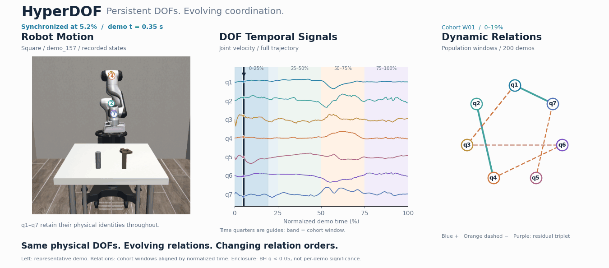
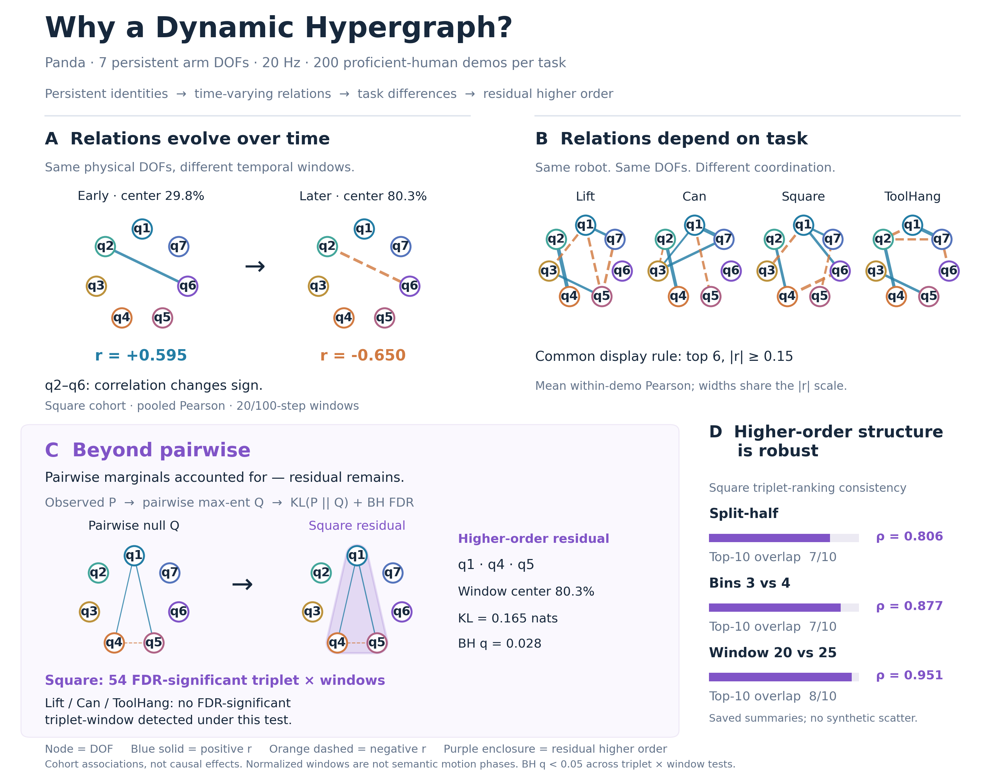

# HyperDOF

**Persistent DOFs. Evolving coordination.**

**Same physical DOFs. Evolving relations. Changing relation orders.**

Robot DOFs are persistent, finite physical entities, while their statistical coordination changes with temporal context and task. Some Square windows contain higher-order residuals beyond a pairwise maximum-entropy model, motivating a **Dynamic Hypergraph** representation that can naturally reduce to a graph.

[Significant-window poster](assets/hyperdof_teaser_poster.png) · [MP4](assets/hyperdof_teaser.mp4)

*Left: one representative Square demonstration. Cursor: its normalized time. Shaded band and relation snapshot: the aligned 200-demo cohort window. Background quarters are time guides, not semantic motion phases; significance is a population-level result.*

## Why a Dynamic Hypergraph?

**A:** the same DOF pair changes correlation sign across normalized windows. **B:** the same Panda has different task-specific relations. **C:** after accounting for all three pairwise marginals, Square has **54 FDR-significant triplet × windows**; Lift, Can and ToolHang have **no FDR-significant triplet-window detected** under the current test. **D:** Square's higher-order rankings remain consistent across splits, bin counts and window sizes.

*Panda · 7 arm DOFs · 20 Hz · 200 proficient-human demonstrations per task. Residual tests use one window-mean sample per demonstration and BH q < 0.05 across all triplet × window tests within each task. Associations motivate a representation; they do not establish causality.*

[Vector figure](assets/preliminary_evidence.svg)

## Project status

This repository presents HyperDOF’s research motivation and preliminary statistical evidence. Implementation code and datasets are not included.

## Acknowledgments

The demonstrations and visualization environment build on [robomimic](https://github.com/ARISE-Initiative/robomimic) and [robosuite](https://github.com/ARISE-Initiative/robosuite).
